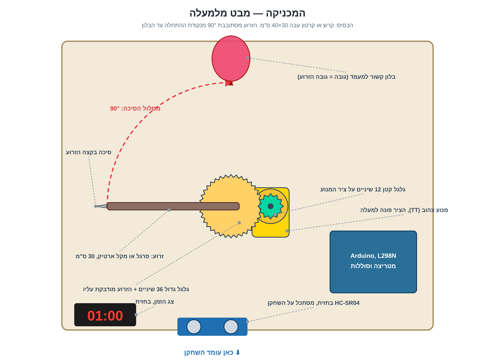
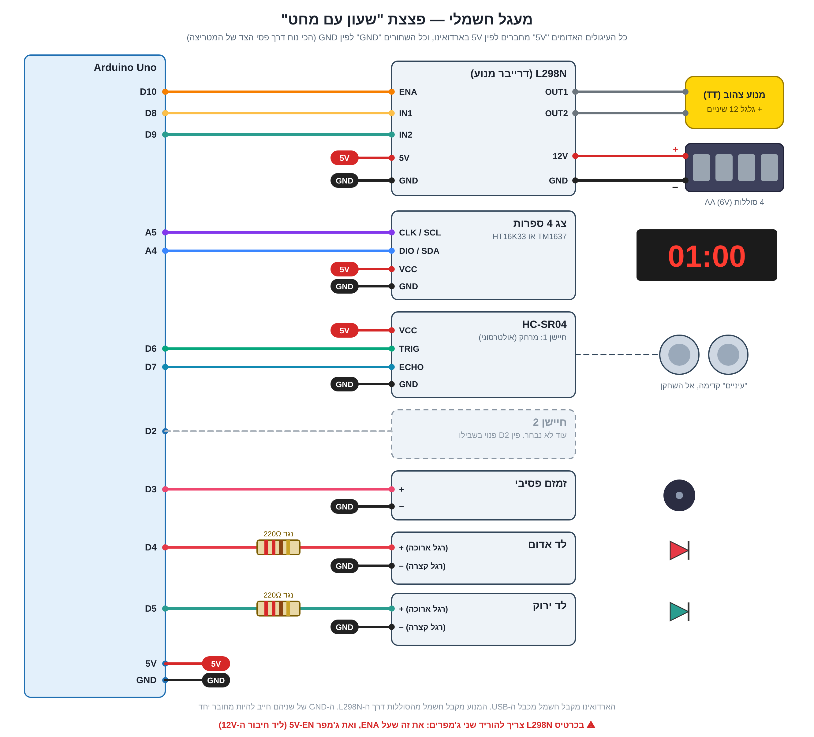

# 🔧 מדריך בנייה: פצצת "שעון עם מחט"

מאפס ועד פצצה שעובדת עם האתר. בונים בסדר הזה: **תוכנה, ואז חשמל, ואז מכניקה**. כך כל חלק נבדק לפני שממשיכים, ואם משהו לא עובד יודעים בדיוק איפה הבעיה.

## איך זה עובד
1. מישהו נעמד מול הפצצה, וחיישן המרחק (**HC-SR04**) מזהה אותו. אחרי 1.5 שניות הפצצה "נדלקת": לד אדום, צפצופים, ו**הצג מתחיל לספור אחורה מ-01:00**.
2. כל חצי שנייה המנוע הצהוב עושה **"תקתוק"**, כלומר תנועה קצרה. הוא מסובב גלגל שיניים קטן, שמסובב גלגל גדול, ועל הגלגל הגדול מודבקת **זרוע עם סיכה**. הזרוע מתקרבת לבלון צעד אחרי צעד, כמו מחוג של שעון.
3. הצפצופים מאיצים ככל שהזמן אוזל.
4. אם השחקן פותר את חידת שפת הסימנים באתר, האתר שולח `D` לארדואינו. המנוע נעצר, הצג קופא על הזמן שנשאר, הלד הירוק נדלק ומתנגנת מנגינת ניצחון.
5. אם הצג מגיע ל-**00:00**, המנוע נותן דחיפה אחרונה, הסיכה מפוצצת את הבלון 💥 והצג מהבהב 00:00.

> **למה "תקתוקים" ולא תנועה רציפה?** המנוע הצהוב מהיר. גם עם התמסורת, תנועה רציפה הייתה מסובבת את הזרוע 90° בפחות משנייה. התקתוקים מאטים את התנועה כך שהיא נמשכת דקה שלמה, וזה גם נראה ונשמע כמו שעון של פצצה.

---

## 1. רשימת קניות

| חלק | כמות | הערות |
|---|---|---|
| Arduino Uno + כבל USB | 1 | |
| **מנוע DC צהוב (TT)**, 3–6V | 1 | יש בו תיבת הילוכים מובנית |
| **דרייבר מנוע L298N** | 1 | |
| מארז ל-**4 סוללות AA** + סוללות | 1 | נותן 6V למנוע |
| **צג 4 ספרות 7-סגמנט** (4 פינים) | 1 | TM1637 או HT16K33, ראו סעיף 2 |
| חיישן מרחק **HC-SR04** | 1 | חיישן 1 |
| **חיישן 2** | 1 | ⚠️ עוד לא נבחר. פין 2 שמור בשבילו |
| זמזם **פסיבי** | 1 | פסיבי ולא אקטיבי, כדי שיוכל לנגן מנגינות |
| לד אדום + לד ירוק | 1+1 | |
| נגד **220Ω** | 2 | אחד לכל לד |
| מטריצה (Breadboard) + חוטי מגשר זכר-זכר וזכר-נקבה | | |
| **גלגל שיניים 12 שיניים + גלגל 36 שיניים** | 1+1 | ראו סעיף 5.2 |
| ציר לגלגל הגדול | 1 | ציר לגו, מסמר עבה או ברגה M4/M5 |
| זרוע: סרגל 30 ס"מ או מקל ארטיק ארוך | 1 | קל ככל האפשר |
| נעץ או סיכה | | בקצה הזרוע |
| בסיס: קרטון עבה, פלקס או עץ 30×40 ס"מ | 1 | |
| בלונים | הרבה 🎈 | לבדיקות ולהצגה |
| דבק חם, סרט דביק דו-צדדי, אזיקונים | | |

**כלים:** אקדח דבק חם, מספריים או סכין יפנית, סרגל, טוש, מברג קטן (בשביל ברגי החיבור של ה-L298N).

---

## 2. איזה צג יש לך?
מסתכלים על הכיתוב ליד 4 הפינים של הצג:

| כתוב על הפינים | סוג הצג | בקוד |
|---|---|---|
| **CLK, DIO**, VCC, GND | TM1637 (הנפוץ ביותר) | משאירים `#define USE_HT16K33 0` |
| **SDA, SCL**, VCC, GND | HT16K33 (I2C) | משנים ל-`#define USE_HT16K33 1` |

בשני המקרים החיבור זהה: הפין הראשון (CLK או SCL) ל-**A5**, והשני (DIO או SDA) ל-**A4**.

---

## 3. תוכנה

1. מתקינים את **Arduino IDE** מ-arduino.cc.
2. **מתקינים את הספרייה של הצג:** בתפריט **Sketch ← Include Library ← Manage Libraries**, מחפשים ומתקינים:
   - צג **TM1637**: הספרייה **"TM1637"** של **Avishay Orpaz**
   - צג **HT16K33**: הספרייה **"Adafruit LED Backpack Library"**. כשהיא שואלת אם להתקין גם ספריות נוספות, עונים **Install all**.
3. **מעתיקים את הקוד:**
   1. נכנסים לקובץ הקוד בגיטהב: [`arduino/bomb/bomb.ino`](https://github.com/noaalfia/Yoav-s-project/blob/claude/dazzling-ptolemy-01fc1r/arduino/bomb/bomb.ino)
   2. לוחצים על כפתור **ההעתקה** (שני ריבועים, "Copy raw file") מעל הקוד, מימין.
   3. ב-Arduino IDE: **File ← New Sketch**. מוחקים את כל מה שכתוב שם (Ctrl+A ואז Delete).
   4. מדביקים (Ctrl+V) ושומרים (Ctrl+S) בשם `bomb`.
4. אם הצג הוא HT16K33, משנים בקוד את `USE_HT16K33` ל-1 (סעיף 2).
5. מחברים את הארדואינו בכבל USB.
6. בתפריט **Tools** בוחרים **Board: Arduino Uno**, ובשדה **Port** בוחרים את הפורט שהופיע.
7. לוחצים **Upload** (החץ ←). צריך להופיע "Done uploading".

> 💡 אפשר להעלות את הקוד עוד **לפני** שמחברים רכיבים. ככה בודקים שהתוכנה והספרייה מותקנות כמו שצריך, ואז בונים את המעגל לפי סעיף 4, רכיב אחרי רכיב.

---

## 4. חשמל: בונים על המטריצה, רכיב אחרי רכיב

### 4.1 הכנה: פסי החשמל
1. חוט אדום מפין **5V** של הארדואינו אל **הפס האדום (+)** בצד המטריצה.
2. חוט שחור מפין **GND** של הארדואינו אל **הפס הכחול (−)**.

מעכשיו, בכל מקום שכתוב **5V** מתחברים לפס האדום, ובכל מקום שכתוב **GND** מתחברים לפס הכחול.

### 4.2 בדיקה: איך בודקים כל רכיב
1. ב-Arduino IDE פותחים **Tools ← Serial Monitor**.
2. למטה מימין בוחרים **9600 baud**.
3. כשהארדואינו נדלק, צריכה להופיע המילה `IDLE`.
4. בשורה העליונה אפשר להקליד פקודה וללחוץ Enter:
   - `S`: מפעיל את הפצצה
   - `D`: מנטרל
   - `R`: מאפס ומחזיר את הזרוע להתחלה

### 4.3 הצג (מתחילים בו, כי הוא הכי קל לבדוק)
| צג | מתחבר ל- |
|---|---|
| CLK (או SCL) | A5 |
| DIO (או SDA) | A4 |
| VCC | 5V |
| GND | GND |

✅ **בדיקה:** לוחצים על כפתור ה-Reset בארדואינו. הצג מראה **01:00**. שולחים `S`, והצג סופר אחורה: 00:59, 00:58... שולחים `D`, והוא קופא.

### 4.4 L298N + מנוע + סוללות
**לפני החיבור, מורידים בכרטיס L298N שני ג'מפרים** (הכיסויים השחורים הקטנים שמחברים שני פינים):
1. **הג'מפר שעל ENA**, ליד IN1. בלעדיו הארדואינו שולט בעוצמה של המנוע.
2. **הג'מפר 5V-EN**, ליד חיבורי הברגים. בלעדיו הכרטיס מקבל 5V נקי מהארדואינו. עם 6V מהסוללות, הווסת שבכרטיס לא נותן 5V יציב.

שומרים את הג'מפרים בצד, כי אולי יהיה צורך בהם בפרויקטים אחרים.

| L298N | מתחבר ל- |
|---|---|
| ENA (הפין שהג'מפר ירד ממנו, **הצמוד ל-IN1**) | פין 10 |
| IN1 | פין 8 |
| IN2 | פין 9 |
| OUT1 + OUT2 (ברגים) | שני החוטים של המנוע הצהוב. הסדר לא משנה, ואפשר להפוך בקוד |
| 12V (בורג) | **+** של מארז הסוללות (חוט אדום) |
| GND (בורג) | **−** של מארז הסוללות (חוט שחור) **וגם** חוט ל-GND של הארדואינו |
| 5V (בורג) | 5V של הארדואינו |

> ⚠️ **הכי חשוב: ה-GND המשותף.** בבורג ה-GND של ה-L298N צריכים להיות שני חוטים: אחד מהסוללות ואחד מה-GND של הארדואינו. בלי זה המנוע לא יגיב לפקודות.

> 💡 אם החוטים של המנוע לא מולחמים, מבקשים מהמורה להלחים, או מלפפים חזק ומכסים בסלוטייפ.

✅ **בדיקה:** מכניסים סוללות ושולחים `S`. כל חצי שנייה המנוע זז מעט ("תקתוק"). שולחים `D` והוא נעצר. שולחים `R` והוא חוזר אחורה.

### 4.5 זמזם + לדים
| רכיב | רגל | מתחבר ל- |
|---|---|---|
| זמזם | + (בדרך כלל מסומן, או הרגל הארוכה) | פין 3 |
| זמזם | − | GND |
| לד אדום | רגל ארוכה | נגד 220Ω, ומהנגד לפין 4 |
| לד אדום | רגל קצרה | GND |
| לד ירוק | רגל ארוכה | נגד 220Ω, ומהנגד לפין 5 |
| לד ירוק | רגל קצרה | GND |

✅ **בדיקה:** שולחים `S`. הלד האדום נדלק ויש צפצופים. שולחים `D`, הלד הירוק נדלק ומתנגנת מנגינה.

### 4.6 חיישן מרחק HC-SR04 (חיישן 1)
| HC-SR04 | מתחבר ל- |
|---|---|
| VCC | 5V |
| Trig | פין 6 |
| Echo | פין 7 |
| GND | GND |

✅ **בדיקה:** שולחים `R` ומחכים ל-`IDLE`. אז מעמידים יד במרחק 30 ס"מ מול "העיניים" של החיישן, ומחכים 1.5 שניות. צריך להופיע `ARMED`, והצג מתחיל לספור.

### 4.7 חיישן 2
> ⚠️ **עוד לא נבחר.** הפרויקט צריך שני חיישנים מסוגים שונים. פין **2** נשאר פנוי בשבילו, וגם בשרטוט המעגל יש לו מקום שמור.

---

## 5. מכניקה

### 5.1 הבסיס
1. חותכים בסיס של 30×40 ס"מ.
2. מסמנים עליו לפי השרטוט: מקום למנוע, מרכז הגלגל הגדול, מסלול הזרוע (רבע עיגול), מקום לבלון, ומקום לצג ולחיישן בחזית.

### 5.2 גלגלי השיניים: בוחרים אחת משלוש דרכים
| דרך | מה צריך | הערות |
|---|---|---|
| **א. לגו טכני** (הכי קל) | גלגל **12 שיניים** (32270) וגלגל **36 שיניים** (32498) | המרחק בין מרכזי הצירים: **24 מ"מ** בדיוק (3 "כפתורים" של לגו). למנוע הצהוב יש **מתאם ללגו** להדפסה בתלת-ממד: מחפשים "TT motor lego adapter" |
| **ב. הדפסה בתלת-ממד** | מחפשים ב-Thingiverse או Printables: "TT motor gear" | יש גלגלים שמתאימים בדיוק לציר של המנוע הצהוב |
| **ג. חיתוך לייזר** מעץ דק או פרספקס | מייצרים גלגלים באתר כמו "gear generator", עם חור בצורת הציר של המנוע | אותו יחס: 12 ו-36 שיניים |

### 5.3 התקנת המנוע והגלגל הקטן
1. משכיבים את המנוע הצהוב **כשהציר פונה למעלה**. לרוב המנועים הצהובים יש ציר משני הצדדים. משתמשים בצד העליון.
2. מקבעים את המנוע לבסיס בדבק חם ובאזיקון. הוא חייב להיות **יציב לגמרי**, אחרת הגלגלים יקפצו.
3. מכניסים את הגלגל הקטן על הציר. אם הוא רופף, מוסיפים טיפת דבק מגע (סופרגלו). חשוב שהגלגל יהיה **ישר במרכז**, אחרת הוא יתנדנד.

### 5.4 הגלגל הגדול והזרוע
1. ממקמים את ציר הגלגל הגדול כך שהשיניים שלו **נוגעות** בשיניים של הגלגל הקטן: לא לוחצות חזק, ולא רופפות.
   - **לגו:** ציר לגו שמוחזק בשתי קורות לגו טכני שמודבקות לבסיס.
   - **אחר:** קודחים חור בבסיס, ומכניסים מסמר עבה או ברגה כציר. אפשר להכניס קשית כ"שרוול" כדי שהציר יסתובב חלק.
2. מסובבים את הגלגל הקטן ביד. הגדול צריך להסתובב חלק, בלי להיתקע.
3. מדביקים את **הזרוע** על **הגלגל הגדול**, כך שהיא מסתובבת איתו.
4. מדביקים **נעץ** בקצה הזרוע, כשהחוד בולט החוצה בכיוון התנועה.

### 5.5 הבלון
1. מעמידים מעמד (כוס הפוכה, קופסה או מקל בתוך פלסטלינה) **בסוף** המסלול של הזרוע, אחרי 90°.
2. קושרים את הבלון כך שהוא בגובה של הנעץ, ושהנעץ יפגע בו כשהזרוע מגיעה לסוף.

### 5.6 צג, חיישן ואלקטרוניקה
1. **הצג:** בחזית, כך שהשחקן רואה אותו טוב.
2. **HC-SR04:** בחזית הבסיס, כש"העיניים" פונות אל המקום שבו השחקן עומד. אסור שהזרוע תעבור מולו.
3. **ארדואינו, L298N, מטריצה וסוללות:** בפינה, רחוק מהזרוע. כדאי לקבע את החוטים באזיקונים, כדי שהזרוע לא תיתפס בהם.

---

## 6. כיול: שהזרוע תגיע לבלון בדיוק ב-00:00

למנוע DC אין ספירת צעדים, אז מכיילים פעם אחת לפי הזמן:

1. **מיקום התחלה:** מסובבים את הזרוע ביד לנקודת ההתחלה.
2. **כיוון:** שולחים `S`. אם הזרוע זזה לכיוון ההפוך מהבלון, משנים בקוד `FLIP_MOTOR = true` ומעלים שוב. אפשר גם פשוט להחליף את שני החוטים של המנוע ב-OUT1 ו-OUT2.
3. **מהירות:** בודקים **בלי בלון** איפה הזרוע נמצאת כשהצג מגיע ל-00:00:
   - הזרוע **לא הגיעה** לבלון: מגדילים את `PULSE_MS`, למשל מ-40 ל-50.
   - הזרוע **הגיעה מוקדם מדי**: מקטינים את `PULSE_MS`, למשל מ-40 ל-30.
   - חוזרים על זה עד שהזרוע מגיעה למקום של הבלון בערך ב-00:00. הדחיפה האחרונה (`FINAL_PUSH_MS`) מסיימת את העבודה.
4. **אם המנוע "מזמזם" ולא זז** בכל תקתוק: מגדילים את `MOTOR_POWER` (עד 255), או את `PULSE_MS`.
5. **בדיקה עם בלון:** שולחים `S` ומחכים. הבלון צריך להתפוצץ בסוף הזמן.

| הגדרה בקוד | מה היא עושה | ברירת מחדל |
|---|---|---|
| `USE_HT16K33` | סוג הצג: 0 = TM1637, 1 = HT16K33 | 0 |
| `TIME_SECONDS` | זמן לפתרון | 60 |
| `PULSE_EVERY_MS` | כל כמה זמן יש תקתוק | 500 |
| `PULSE_MS` | כמה זמן המנוע עובד בכל תקתוק. **את זה מכיילים** | 40 |
| `MOTOR_POWER` | עוצמת המנוע (0–255) | 200 |
| `FINAL_PUSH_MS` | הדחיפה האחרונה כשהזמן נגמר | 600 |
| `FLIP_MOTOR` | הופך את כיוון הסיבוב | false |
| `ARM_CM` | ממרחק כמה ס"מ החיישן מפעיל את הפצצה | 60 |

> 💡 כשהסוללות מתרוקנות המנוע נחלש, וייתכן שיהיה צריך לכייל שוב. **ביום ההצגה כדאי לשים סוללות חדשות.**

---

## 7. חיבור לאתר
1. **סוגרים את ה-Serial Monitor.** רק תוכנה אחת יכולה להשתמש בחיבור לארדואינו בכל רגע.
2. פותחים את האתר ב-Chrome ולוחצים **"חיבור לארדואינו"**. בוחרים את הפורט של הארדואינו.
3. עומדים מול הפצצה. היא נדלקת, הצג סופר אחורה, והפס באתר מתקדם.
4. מסמנים את המילה מול המצלמה. כשהאתר מזהה אותה, המנוע נעצר, הצג קופא והלד הירוק נדלק ✔.
5. אחרי כל משחק לוחצים **"איפוס"** באתר: הזרוע חוזרת להתחלה. אם היא לא חזרה בדיוק, מתקנים ביד.

---

## 8. תקלות נפוצות

| תקלה | פתרון |
|---|---|
| המנוע לא זז בכלל | בודקים: הג'מפר הורד מ-ENA, ENA מחובר לפין 10, יש סוללות, **ו-GND של הסוללות מחובר גם ל-GND של הארדואינו** |
| המנוע מזמזם אבל לא זז | מגדילים את `MOTOR_POWER` או את `PULSE_MS`. בודקים שהגלגלים לא תקועים |
| המנוע מסתובב כל הזמן ולא בתקתוקים | ENA מחובר ל-5V או שהג'מפר עדיין עליו. מחברים אותו לפין 10 |
| הצג חשוך | בודקים VCC ו-GND, ש-CLK ב-A5 ו-DIO ב-A4, ושנבחר סוג הצג הנכון בקוד |
| הצג מראה שטויות | כנראה שהוחלפו CLK ו-DIO. מחליפים בין A4 ל-A5 |
| שגיאה בהעלאת הקוד: `TM1637Display.h: No such file` | לא הותקנה ספריית הצג (סעיף 3) |
| הגלגלים "קופצים" שן | מקרבים קצת את הצירים זה לזה, או מקבעים את המנוע חזק יותר |
| הפצצה נדלקת לבד | יש משהו מול החיישן: קיר, או הזרוע עצמה. מקטינים את `ARM_CM` |
| אין צליל | בודקים שהזמזם פסיבי, ושה-+ שלו בפין 3 |
| האתר לא מתחבר לארדואינו | סוגרים את ה-Serial Monitor ב-Arduino IDE |
| הבלון לא מתפוצץ | מנפחים את הבלון יותר, מחדדים או מחליפים את הנעץ, או מגדילים את `FINAL_PUSH_MS` |

---

## 9. לפרזנטציה: התמסורת

- **שתי תמסורות בשרשרת:**
  1. **תיבת ההילוכים שבתוך המנוע הצהוב:** בדרך כלל יחס **1:48**. המנוע הפנימי מסתובב פי 48 מהר יותר מהציר שיוצא החוצה.
  2. **הגלגלים שלנו:** 36 ÷ 12 = יחס **1:3**.
- **יחס כולל:** 48 × 3 = **144**. המנוע הפנימי מסתובב 144 סיבובים בשביל סיבוב אחד של הזרוע, ולכן לזרוע יש **פי 144 יותר מומנט** (כוח סיבוב).
- **הדרייבר L298N:** הארדואינו לא יכול לספק מספיק זרם למנוע, ולכן ה-L298N הוא "המתווך". הארדואינו אומר לו לאיזה כיוון ובאיזו עוצמה, והוא לוקח את החשמל מהסוללות.
- **הצג:** הארדואינו סופר את הזמן בעצמו (`millis()`), ומציג על הצג דקות ושניות.
